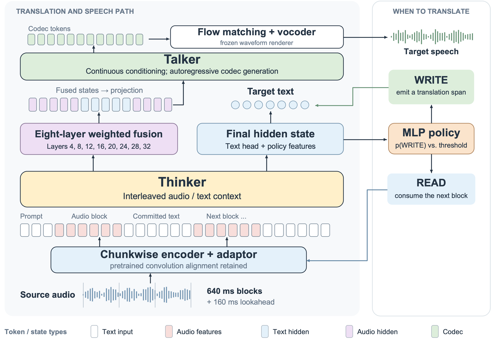

# S3-S2ST

Semantically Supervised Streaming Speech-to-Speech Translation

[arXiv](https://arxiv.org/abs/2610.36777) · Hugging Face: **Under review — Coming soon** · ModelScope: **Under review — Coming soon**

[中文](README.zh-CN.md)

## Abstract

Streaming speech-to-speech translation requires timely decisions about when partial input is sufficient for accurate translation. We present S3-S2ST, a model that learns to translate and speak from semantically aligned streaming supervision. By converting utterance-level speech pairs into incremental training examples, we teach a learned policy when to commit translations. Its adjustable threshold controls the quality–latency tradeoff on a fixed 640 ms input grid. S3-S2ST delivers competitive English–Chinese translation on FLEURS and leads the evaluated streaming systems in translation quality on the internal 9pair test set. On RealSI, adapting the threshold to buffered speech further improves quality over a low fixed threshold with little change in first-audio latency. We plan to release the model and the training, inference, and data-construction code.



A chunkwise encoder and Thinker support translation and READ/WRITE decisions. Eight-layer fusion conditions the Talker; flow matching and a vocoder generate speech.

## Installation

### Clone and system dependencies

Use Linux x86_64 with an NVIDIA GPU and a CUDA-compatible driver.

```bash
git clone https://github.com/QwenAudio/S3-S2ST.git
cd S3-S2ST
sudo apt-get update
sudo apt-get install -y git ffmpeg libsndfile1 cmake ninja-build build-essential python3-venv
```

### Inference environment

The reference environment uses Python 3.12, NVIDIA PyTorch 2.7.0a0 (25.03), CUDA 12.8, torchaudio 2.6.0a0 and Triton 3.2.0. Use the NVIDIA PyTorch 25.03 container or a compatible CUDA/PyTorch base. The bundled vLLM Python code requires compiled vLLM kernels compatible with commit `6ac0cd370316e7c940d237e803b0eb8eda282f01`.

```bash
python3.12 -m venv --system-site-packages envs/inference312
# Install your compatible compiled vLLM wheel before the Python dependencies.
envs/inference312/bin/python -m pip install "<path_to_compatible_vllm.whl>"
PIP_CACHE_DIR="$PWD/cache/pip" envs/inference312/bin/python -m pip install -r requirements-inference.txt
source env.sh
envs/inference312/bin/python -c 'from vllm.engine.omnidrca2_engine import OmniDRCA2Engine; import onnxruntime'
```

### Training and evaluation environments

Install CUDA-matched PyTorch/torchaudio, NVIDIA Apex, Transformer Engine and flash-attn in the training environment. Compile the bundled Megatron fused kernels against that environment.

```bash
python3.10 -m venv envs/train
envs/train/bin/python -m pip install -r requirements-training.txt

python3.12 -m venv --system-site-packages envs/metrics312
envs/metrics312/bin/python -m pip install -r requirements-metrics.txt
```

The launchers select their corresponding inference or metrics environment automatically. Activate `envs/train` for training. Set `PYTHON_BIN="<path_to_python>"` to use a different interpreter.

## Inference

### Model setup

Download and install either release from Hugging Face (model repositories are under review — coming soon):

```bash
envs/inference312/bin/python tools/download_model.py --mode streaming --repo-id "<hf_streaming_repo>"
envs/inference312/bin/python tools/download_model.py --mode offline --repo-id "<hf_offline_repo>"
# For files downloaded manually, replace --repo-id with --local-dir "<path_to_model_download>".
```

Each release includes its matching 4B weights, Talker configuration and rendering assets. The installer verifies checksums and places files under `models/`; no external model paths are needed. Pin `--revision "<hf_commit>"` to select an exact release. For verification without installation, add `--verify-only`.

The two releases are named `streaming` and `offline`, without step or iteration suffixes. Place the bundles and shared assets inside the repository:

```text
models/
  streaming/              # HF export, audio_encoder.pt, streaming_gate.pt, fusion weights
  offline/                # HF export and audio_encoder.pt
  speaker/campplus.onnx
  flow_matching/          # shared flow-matching weights
  vocoder/                # shared vocoder weights and configuration
  frontend/               # mel_filters.npz and fm_mel_filters.npz
  training/talker_native.pth
checkpoints/
  init_streaming_talker/   # Megatron checkpoint parent and iteration tracker
  init_streaming_e2e/
  init_offline/
```

### Translate an audio file

```bash
envs/inference312/bin/python tools/make_input.py --audio "<path_to_input.wav>" --direction zh2en --output data/input.jsonl
bash scripts/infer.sh --mode streaming --preset dynamic099 --model "<path_to_streaming_model>" --input data/input.jsonl --no-warmup --output runs/example --gpu 0
```

Use `--direction en2zh` for English-to-Chinese translation. For offline inference, use `--mode offline --model "<path_to_offline_model>"` and omit `--preset`. Streaming supports `fixed05`, `fixed01` and `dynamic099`. Audio, model and output paths resolve inside the repository; use a new output directory for each run. Outputs include `raw.jsonl`, generated audio and codec tokens.

### FLEURS preparation and evaluation

```bash
envs/inference312/bin/python tools/prepare_fleurs.py
bash scripts/infer.sh --mode streaming --preset dynamic099 --input data/fleurs/test_all.jsonl --output runs/fleurs_stream --gpu 0
bash scripts/evaluate.sh --run fleurs_stream --gpu 0 --full --skip-comet
envs/metrics312/bin/python tools/report.py --run runs/fleurs_stream
```

Preparation downloads official metadata and audio, checks SHA256 and builds the paper subset: 945 ZH→EN and 646 EN→ZH examples. For an offline server, populate `cache/downloads/fleurs_hf/` first; pinned filenames and hashes are in `configs/fleurs_subset.json` and `configs/fleurs_archive_verified.json`.

Place evaluation assets under `evaluation/third_party/cer_tool_parallel/models/`, `evaluation/third_party/torch_cache/` and `evaluation/voice_eval/thirdparty/3D-Speaker/pretrained/`. `--skip-comet` leaves COMET and ASR-COMET empty. To enable them, obtain the official XCOMET-XL checkpoint, run `tools/prepare_assets.py`, and omit the flag. Scores are written to `quality/summary.tsv` and averaged equally across directions.

Optional whole-file gain preprocessing and parallel streaming decoding:

```bash
envs/inference312/bin/python tools/boost_fleurs.py "<path_to_fleurs_audio>" --output-dir "<path_to_new_audio_directory>"
bash scripts/infer_parallel.sh --output runs/fleurs_parallel --gpus 0,1 --workers-per-gpu 2 --skip-metrics
```

The parallel entry applies gain automatically: RMS target 0.0743324953, peak limit 0.95, boost only. It uses `fixed05`, FM8 and 1 GiB KV cache per engine. The single-worker entry uses the original audio. Gain preprocessing is optional and separate from the published results. Concurrent latency measures throughput conditions; measure single-request latency without competing workers. For separately preprocessed audio, update the input manifest to reference the new files.

## Training

### Prepare data

Supply licensed bilingual audio, semantic chunks and word alignments. The original private training corpus is not distributed.

```bash
source envs/train/bin/activate
python training/data_tools/build_interleaved_data.py --direction zh2en --mapping "<path_to_mapping.jsonl>" --text-labels "<path_to_semantic_chunks.jsonl>" --word-alignments "<path_to_word_alignments.jsonl>" --output-dir data/train/zh2en --sqlite cache/zh2en.sqlite
python training/data_tools/pack_streaming_s2tt.py --input-list "<path_to_generated_data.list>" --output-dir data/train/packed --funasr-root vendor/FunASR --tokenizer-model models/offline --cutoff-len 8192
```

Repeat for `en2zh`. The packer builds streaming S2TT examples; S2ST additionally needs aligned target speech and precomputed FSQ codec slices. See the schema in `training/streaming/talker/runtime/exact_codec_loader.py`: 12.5 Hz codec frames, blank count 5, BOS 59049 and EOS 59050. Each `data.list` contains one local packed JSONL shard path per line. Keep data and media dependencies inside the repository.

### Run training

```bash
# Streaming: 8 GPUs, Talker adaptation followed by end-to-end training.
bash scripts/train.sh --stage streaming-talker --train-list "<path_to_train_data.list>" --valid-list "<path_to_valid_data.list>" --output runs/train_talker --steps 5000
bash scripts/train.sh --stage streaming-e2e --train-list "<path_to_train_data.list>" --valid-list "<path_to_valid_data.list>" --output runs/train_e2e --steps 4000

# Offline: 4 nodes × 8 GPUs; set NODE_RANK=0..3 on the corresponding nodes.
NNODES=4 NODE_RANK=0 MASTER_ADDR="<node0_address>" MASTER_PORT=12981 bash scripts/train.sh --stage offline --train-list "<path_to_offline_data.list>" --output runs/train_offline --steps 10000
```

Each stage defaults to its initializer under `checkpoints/`. Pass `--init "<path_to_checkpoint_parent>"` to select another initialization, including the preceding stage's output. Use `--prepare-only` to generate stage configuration before training. Offline nodes share the same project, data and output paths.

## License

Original project code and documentation use MIT. Third-party code, models and datasets retain their own licenses; see `LICENSE` and `THIRD_PARTY_NOTICES.md`.
