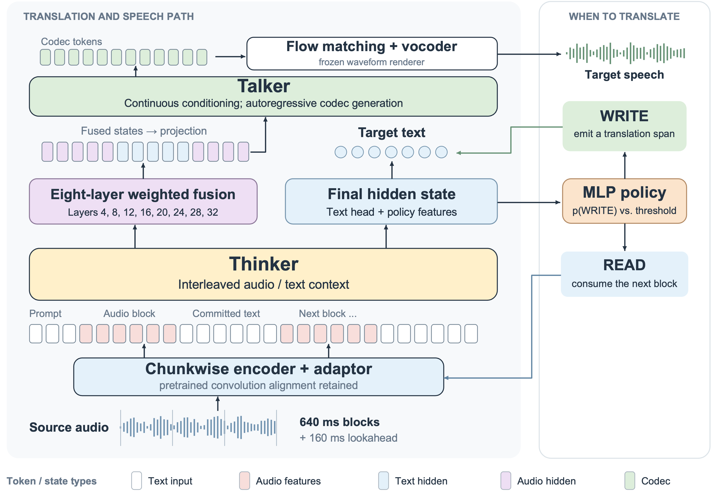

# S3-S2ST

语义监督的流式语音到语音翻译

[](https://arxiv.org/abs/2610.36777)
[](https://huggingface.co/zhaoyx39/S3-S2ST)
[](https://modelscope.cn/models/zhaoyx239/S3-S2ST)

[English](README.md)

## 摘要

流式语音到语音翻译需要及时判断局部输入是否足以支持准确翻译。S3-S2ST 从语义对齐的流式监督中学习翻译和语音生成：将句级语音对转换为增量训练样本，监督策略学习何时提交译文。策略的可调阈值在固定 640 ms 输入网格上控制质量与延迟的权衡。S3-S2ST 在 FLEURS 上取得有竞争力的英汉翻译效果，在内部 9pair 测试集的翻译质量上领先所评测的流式系统；在 RealSI 上，根据待播放语音调整阈值，相比低固定阈值进一步提高质量，同时首音频延迟变化较小。我们计划公开模型以及训练、推理和数据构建代码。



分块编码器和 Thinker 负责翻译及 READ/WRITE 决策；八层融合为 Talker 提供条件，流匹配与声码器生成语音。

## 环境安装

### 克隆仓库和安装系统依赖

使用 Linux x86_64、NVIDIA GPU 和与 CUDA 兼容的驱动。

```bash
git clone https://github.com/QwenAudio/S3-S2ST.git
cd S3-S2ST
sudo apt-get update
sudo apt-get install -y git ffmpeg libsndfile1 cmake ninja-build build-essential python3-venv
```

### 推理环境

参考环境为 Python 3.12、NVIDIA PyTorch 2.7.0a0（25.03）、CUDA 12.8、torchaudio 2.6.0a0 和 Triton 3.2.0。使用 NVIDIA PyTorch 25.03 容器或兼容的 CUDA/PyTorch 基础环境，执行以下命令。仓库自带的 vLLM Python 代码需要与提交 `6ac0cd370316e7c940d237e803b0eb8eda282f01` 兼容的编译内核。

```bash
python3.12 -m venv --system-site-packages envs/inference
# 先安装兼容的 vLLM 编译 wheel，再安装 Python 依赖。
envs/inference/bin/python -m pip install "<path_to_compatible_vllm.whl>"
PIP_CACHE_DIR="$PWD/cache/pip" envs/inference/bin/python -m pip install -r requirements-inference.txt
source env.sh
envs/inference/bin/python -c 'from vllm.engine.omnidrca2_engine import OmniDRCA2Engine; import onnxruntime'
```

### 训练与评测环境

在训练环境中安装与 CUDA 匹配的 PyTorch/torchaudio、NVIDIA Apex、Transformer Engine 和 flash-attn，并在同一环境编译 Megatron 融合算子。

```bash
python3.10 -m venv envs/train
envs/train/bin/python -m pip install -r requirements-training.txt

python3.12 -m venv --system-site-packages envs/metrics
envs/metrics/bin/python -m pip install -r requirements-metrics.txt
```

启动脚本自动选择对应的推理或评测环境。训练前激活 `envs/train`；使用其他解释器时设置 `PYTHON_BIN="<path_to_python>"`。

## 推理

### 模型准备

从 Hugging Face 下载并安装流式或离线版本：

```bash
envs/inference/bin/python tools/download_model.py --mode streaming --repo-id zhaoyx39/S3-S2ST --subfolder streaming
envs/inference/bin/python tools/download_model.py --mode offline --repo-id zhaoyx39/S3-S2ST --subfolder offline
# 手动下载时，将 --repo-id 替换为 --local-dir "<path_to_model_download>"。
```

或从 ModelScope 下载，再用相同的安装脚本安装：

```bash
envs/inference/bin/python -m pip install modelscope
envs/inference/bin/modelscope download --model zhaoyx239/S3-S2ST --include "streaming/**" --local_dir cache/model_downloads/modelscope
envs/inference/bin/python tools/download_model.py --mode streaming --local-dir cache/model_downloads/modelscope --subfolder streaming
envs/inference/bin/modelscope download --model zhaoyx239/S3-S2ST --include "offline/**" --local_dir cache/model_downloads/modelscope
envs/inference/bin/python tools/download_model.py --mode offline --local-dir cache/model_downloads/modelscope --subfolder offline
```

同一模型仓库下的 `streaming/` 和 `offline/` 子目录分别包含对应的 4B 权重、Talker 配置和语音渲染组件。安装脚本校验哈希并将文件放入 `models/`，无需引用外部模型路径。使用 `--revision "<hf_commit>"` 固定版本；添加 `--verify-only` 可只校验、不安装。

对外仅区分 `streaming`（流式）和 `offline`（离线）两个模型，不在模型名中添加 step 或 iteration 后缀。下载后将模型与公共组件按以下结构放入仓库：

```text
models/
  streaming/              # HF export, audio_encoder.pt, streaming_gate.pt, fusion weights
  offline/                # HF export and audio_encoder.pt
  speaker/campplus.onnx
  flow_matching/          # shared flow-matching weights
  vocoder/                # shared vocoder weights and configuration
  frontend/               # mel_filters.npz and fm_mel_filters.npz
  training/talker_native.pth
checkpoints/
  init_streaming_talker/   # Megatron checkpoint parent and iteration tracker
  init_streaming_e2e/
  init_offline/
```

### 单条音频推理

```bash
envs/inference/bin/python tools/make_input.py --audio "<path_to_input.wav>" --direction zh2en --output data/input.jsonl
bash scripts/infer.sh --mode streaming --preset adaptive --model "<path_to_streaming_model>" --input data/input.jsonl --no-warmup --output runs/example --gpu 0
```

英译中使用 `--direction en2zh`。离线推理使用 `--mode offline --model "<path_to_offline_model>"`，去掉 `--preset`。流式支持 `fixed-0.5`、`fixed-0.1` 和 `adaptive`。音频、模型和输出路径须位于仓库内，每次使用新的输出目录。结果包括 `raw.jsonl`、生成音频和 codec token。

### FLEURS 数据准备与评测

```bash
envs/inference/bin/python tools/prepare_fleurs.py
bash scripts/infer.sh --mode streaming --preset adaptive --input data/fleurs/test_all.jsonl --output runs/fleurs_stream --gpu 0
bash scripts/evaluate.sh --run fleurs_stream --gpu 0 --full --skip-comet
envs/metrics/bin/python tools/report.py --run runs/fleurs_stream
```

准备脚本下载官方元数据与音频，校验 SHA256，构建论文子集：945 条中译英和 646 条英译中。离线服务器先将下载文件放入 `cache/downloads/fleurs_hf/`；文件名和哈希见 `configs/fleurs_subset.json` 与 `configs/fleurs_archives.json`。

评测模型分别放入 `evaluation/third_party/cer_tool_parallel/models/`、`evaluation/third_party/torch_cache/` 和 `evaluation/voice_eval/thirdparty/3D-Speaker/pretrained/`。`--skip-comet` 跳过 COMET 和 ASR-COMET；需要这两个指标时，获取官方 XCOMET-XL 权重，运行 `tools/prepare_assets.py` 并去掉该参数。得分写入 `quality/summary.tsv`，按两个方向等权平均。

可选的整条音频增益预处理与并行流式推理：

```bash
envs/inference/bin/python tools/boost_fleurs.py "<path_to_fleurs_audio>" --output-dir "<path_to_new_audio_directory>"
bash scripts/infer_parallel.sh --output runs/fleurs_parallel --gpus 0,1 --workers-per-gpu 2 --skip-metrics
```

并行入口自动应用增益：RMS 目标 0.0743324953、峰值上限 0.95，仅放大。使用 `fixed-0.5`、FM8，每个引擎分配 1 GiB KV 缓存。单 worker 入口使用原音频。增益预处理是独立于论文结果的可选流程；并发时延反映吞吐场景，单请求时延应在无竞争 worker 时测量。单独预处理音频后，需要更新输入清单中的音频路径。

## 训练

### 数据准备

准备有使用授权的双语音频、语义分块和词级对齐。原始私有训练语料不随仓库发布。

```bash
source envs/train/bin/activate
python training/data_tools/build_interleaved_data.py --direction zh2en --mapping "<path_to_mapping.jsonl>" --text-labels "<path_to_semantic_chunks.jsonl>" --word-alignments "<path_to_word_alignments.jsonl>" --output-dir data/train/zh2en --sqlite cache/zh2en.sqlite
python training/data_tools/pack_streaming_s2tt.py --input-list "<path_to_generated_data.list>" --output-dir data/train/packed --funasr-root vendor/FunASR --tokenizer-model models/offline --cutoff-len 8192
```

对 `en2zh` 重复相同步骤。打包器生成流式 S2TT 样本；S2ST 还需要对齐的目标语音与预计算的 FSQ codec 切片。数据格式见 `training/streaming/talker/runtime/exact_codec_loader.py`：codec 帧率 12.5 Hz、blank 数量 5、BOS 59049、EOS 59050。`data.list` 每行填写一个本地打包 JSONL 分片路径，数据及音频依赖放在仓库内。

### 启动训练

```bash
# Streaming: 8 GPUs, Talker adaptation followed by end-to-end training.
bash scripts/train.sh --stage streaming-talker --train-list "<path_to_train_data.list>" --valid-list "<path_to_valid_data.list>" --output runs/train_talker --steps 5000
bash scripts/train.sh --stage streaming-e2e --train-list "<path_to_train_data.list>" --valid-list "<path_to_valid_data.list>" --output runs/train_e2e --steps 4000

# Offline: 4 nodes × 8 GPUs; set NODE_RANK=0..3 on the corresponding nodes.
NNODES=4 NODE_RANK=0 MASTER_ADDR="<node0_address>" MASTER_PORT=12981 bash scripts/train.sh --stage offline --train-list "<path_to_offline_data.list>" --output runs/train_offline --steps 10000
```

各阶段默认加载 `checkpoints/` 中对应的初始化模型。使用 `--init "<path_to_checkpoint_parent>"` 指定其他初始化，包括上一阶段的训练输出。`--prepare-only` 可先生成阶段配置。离线训练各节点共享相同的项目、数据和输出路径。

## 引用

如果本项目对你的研究有帮助，请引用：

```bibtex
@misc{zhao2026s3s2st,
  title={{S3-S2ST}: Semantically Supervised Streaming Speech-to-Speech Translation},
  author={Yuxiang Zhao and Zhiyun Fan and Yu Pu and Yanjie An and Yushen Chen and
          Wenrui Liang and Baiji Liu and Yunchong Xiao and Zhaoci Liu and Keqi Deng and
          Kai Yu and Zhifu Gao and Xiangang Li and Xie Chen},
  year={2026},
  eprint={2610.36777},
  archivePrefix={arXiv},
  primaryClass={cs.SD},
  url={https://arxiv.org/abs/2610.36777}
}
```

## 许可

项目原创代码及文档采用 MIT 许可。第三方代码、模型和数据集保留各自许可，见 `LICENSE` 与 `THIRD_PARTY_NOTICES.md`。
